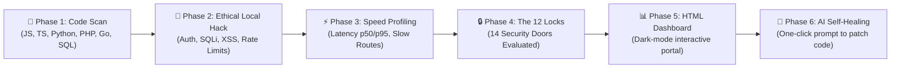

<div align="center">

# 😎 Cool-Tester

### ⚡ Autonomous AI Security & Penetration Testing Co-Pilot for Vibe Coders

**One Command. Zero Cloud Telemetry. The 12 Locks Evaluation. Self-Healing AI Prompts.**

[](https://github.com/muhdanashakkeem-stack/cool-tester)
[](https://github.com/muhdanashakkeem-stack/cool-tester)
[](https://modelcontextprotocol.io)
[](#-privacy-safety--legal-guarantees)
[](LICENSE)

<br/>

```bash
# 🚀 Run the entire audit pipeline with ONE command:
npx cool-tester audit

# 📊 View the real-time interactive cyber security dashboard:
npx cool-tester dashboard
```

</div>

---

## 🌟 Why Cool-Tester?

When coding at the speed of thought with AI agents (**Cursor, Claude Code, Antigravity, Copilot**), critical security vulnerabilities and performance bottlenecks are easily missed. 

**Cool-Tester acts as your autonomous ethical hacker and testing engineer.** It safely inspects your code, actively attacks your local application on `localhost`, scores your defenses against **The 12 Locks**, and generates an exact self-healing prompt for your AI agent to fix every issue automatically.

| Feature | Traditional Linters | Cloud Scanners | 😎 Cool-Tester |
| :--- | :---: | :---: | :---: |
| **Realtime Localhost Attack** | ❌ No | ❌ Complex / Remote |  **Autonomous Local Probing** |
| **The 12 Locks Evaluation** | ❌ No | ❌ No |  **Built-in Scorecard** |
| **Universal AI MCP Support** | ❌ No | ❌ No |  **Plug-and-play for all AIs** |
| **Interactive HTML Dashboard** | ❌ Raw text | ❌ Cloud account needed |  **100% Local Dark-Mode Portal** |
| **AI Remediation Prompts** | ❌ No | ❌ Generic hints |  **Ready-to-paste AI fix plan** |
| **Privacy & Zero Telemetry** |  Local | ❌ Sends code to cloud |  **100% Offline / Zero API Keys** |

---

## ⚡ Quick Start: The One-Command Pipeline

Run the complete autonomous audit against your current directory:

```bash
npx cool-tester audit
```

> **Targeting a specific dev server?**
> ```bash
> npx cool-tester audit --port 5000
> # or: npx cool-tester audit --url http://localhost:8000
> ```

### 🔄 The 6-Phase Autonomous Engine



1. **Phase 1: Source Code & Secret Auditing** — Audits project files across multiple languages (JS, TS, HTML, CSS, SQL, PHP, Go). Catches hardcoded API keys and verifies `.env` protection.
2. **Phase 2: Localhost Ethical Attack** — Auto-detects live dev servers (5000, 3000, 5173, 8000, 8080...) and ethically attacks `localhost` for Auth bypass, CORS leaks, Missing Rate Limits, Reflected XSS, and SQL Injection.
3. **Phase 3: Speed & Latency Profiling** — Samples route latency, measures p50/p95 response times, and detects unindexed queries or slow endpoints.
4. **Phase 4: The 12 Locks Evaluation** — Grades your application against The 12 Locks (+2 Bonus) and generates a security health score (0–100, Grade A–F).
5. **Phase 5: Interactive HTML Dashboard** — Generates a modern standalone visual dashboard at `.cool-tester/dashboard.html`.
6. **Phase 6: AI Remediation Fix Prompt** — Generates an actionable, step-by-step fix prompt ready to copy directly into your AI coding assistant.

---

## 📊 Interactive HTML Cyber Dashboard

View your findings in a modern, dark-mode cyber security portal with real-time severity filters, route search, and lock progress tracking:

```bash
npx cool-tester dashboard
```
*Launches automatically in your default browser on `http://localhost:3333`.*

- **Live Severity Filtering:** Instantly filter Critical, High, Medium, and Low vulnerabilities.
- **Searchable Findings:** Search routes, error messages, and rule explanations in real time.
- **Visual Progress Bar:** Real-time percentage of doors secured vs. open.
- **One-Click AI Prompt Copy:** Instant copy button to send the remediation instructions to your AI.

---

## 🤖 Connect to AI Coding Agents via MCP (Zero-Install)

Anyone in the world can connect **Cool-Tester** directly into their favorite AI agent (**Claude Code**, **Cursor**, **Antigravity**, **VS Code**, **Windsurf**, or **Claude Desktop**) with zero API keys required!

### 🌍 Universal Setup (Global NPX)

#### 1. Claude Code
Run directly in your terminal:
```bash
claude mcp add cool-tester npx -y github:muhdanashakkeem-stack/cool-tester mcp
```

#### 2. Cursor / Windsurf
Navigate to **Cursor Settings** ➔ **Features** ➔ **MCP** ➔ **Add Server**:
- **Name:** `cool-tester`
- **Type:** `command` (or `stdio`)
- **Command:** `npx -y github:muhdanashakkeem-stack/cool-tester mcp`

#### 3. Antigravity / VS Code / Claude Desktop / Gemini CLI
Add this to your MCP configuration file (`mcp_config.json` or `claude_desktop_config.json`):
```json
{
  "mcpServers": {
    "cool-tester": {
      "command": "npx",
      "args": ["-y", "github:muhdanashakkeem-stack/cool-tester", "mcp"]
    }
  }
}
```

---

### 💬 Talk to Your AI Agent

Once connected via MCP, your AI can test and fix your project autonomously. Just prompt:

> *"Audit my project with cool-tester, test my local server on port 5000, and fix any security vulnerabilities."*

Your AI will autonomously:
1. Call `audit_project` to scan code, attack `localhost`, and evaluate the 12 Locks.
2. Review the vulnerabilities, open doors, and missing rate limits.
3. Automatically patch the vulnerable code and secure server routes.
4. Call `verify_fix` to confirm that all doors are locked!

#### 🛠️ MCP Tools Exposed to Your AI:
- `audit_project`: Complete autonomous pipeline in one call (scan + attack + 12 locks + dashboard).
- `check_code`: Static security and secret leak scanner.
- `start_attack`: Dynamic localhost ethical probes and latency benchmarks.
- `lock_report`: 12 Locks status evaluator.
- `get_fix_prompt`: Step-by-step remediation plan for AI self-healing.
- `verify_fix`: Verification loop to confirm resolved vulnerabilities.

---

## 🔒 The 12 Locks (+2 Bonus)

The 12 Locks are the most critical security doors that AI coding assistants and developers commonly leave open:

| # | Group | Lock Name | What AI Leaves Open |
| :-: | :--- | :--- | :--- |
| **1** | Secrets & Storage | **API keys exposed to browser** | Hardcoded Stripe, OpenAI, or AWS keys in client-side bundles |
| **2** | Secrets & Storage | **Secrets in Git history** | Deleted keys that remain accessible in `.git` commit logs |
| **3** | Secrets & Storage | **Database readable by anyone** | Disabled Row Level Security (RLS) or public database URLs |
| **4** | Access Control | **Login checked only in page** | Frontend redirects without server-side route guards / 401s |
| **5** | Access Control | **IDOR (Insecure Direct Object Reference)** | Changing an ID in the URL lets users read someone else's data |
| **6** | Access Control | **Server trusts whole request body** | Mass-assignment vulnerabilities (user sets `role: "admin"`) |
| **7** | Access Control | **No rate limiting** | Unlimited login attempts allowing password brute-forcing |
| **8** | Data In & Out | **Input checked in browser only** | Missing server-side payload validation and sanitization |
| **9** | Data In & Out | **SQL Injection** | Dynamic SQL queries constructed using string concatenation |
| **10** | Data In & Out | **User content shown as raw HTML (XSS)** | Unescaped user inputs rendered directly in the DOM |
| **11** | Data In & Out | **Uploads accept anything** | Unrestricted file uploads without size or MIME type caps |
| **12** | Data In & Out | **API returns the whole record** | `SELECT *` returning password hashes and internal fields |
| **13** | *Bonus* | **Error pages show stack traces** | Detailed server crash dumps leaking file paths to attackers |
| **14** | *Bonus* | **CORS open to every website** | `Access-Control-Allow-Origin: *` with credentials enabled |

---

## 🛠️ Complete CLI Reference

| Command | Arguments | Description |
| :--- | :--- | :--- |
| `cool-tester audit [path]` | `--port`, `--url`, `--token` | **Full autonomous pipeline**: static scan, localhost ethical hack, speed test, 12 locks & dashboard |
| `cool-tester dashboard [path]` | `--port`, `--no-open` | Launch interactive HTML dashboard in browser *(default port 3333)* |
| `cool-tester check [path]` | `--fail-on <level>`, `--json` | Static code scan, git commit history check & `.env` verification |
| `cool-tester fix [path]` | *(none)* | Automatically creates or updates `.gitignore` to protect `.env` secrets |
| `cool-tester locks [path]` | `--how`, `--fail-on-open` | Score application against The 12 Locks (`--how` displays manual tests) |
| `cool-tester attack <url>` | `--path`, `--port`, `--token` | Ethically probes local app on `localhost` (Auth, CORS, Rate Limit, XSS, SQLi) |
| `cool-tester report [path]` | `--fix-prompt`, `--json` | Display latest combined report or generate AI self-healing prompt |
| `cool-tester verify [path]` | `--token`, `--json` | Re-run only previously failed checks to confirm all doors are locked |
| `cool-tester mcp` | *(none)* | Start Model Context Protocol server for AI coding agents |

---

## 🛡️ Privacy, Safety & Legal Guarantees

- **100% Offline & Free:** Runs entirely on your local machine. No cloud telemetry, no analytics, no external tracking, and zero subscription fees.
- **Never Reads `.env` Secrets:** Cool-Tester verifies whether `.env` is uncommitted and safely listed in `.gitignore` **without ever opening or reading the secret values inside**.
- **Zero-Leak Secret Masking:** Discovered keys are always masked (`sk-p****`). Never exposes production credentials in terminal logs or AI prompts.
- **Strict Localhost Safety Lock:** Cool-Tester strictly refuses to attack anything other than `localhost`, `127.0.0.1`, or `::1`. It is purely a defensive developer tool with zero legal risk.

---

<div align="center">

Made with ❤️ for the global vibe-coding community.

**[⭐ Star on GitHub](https://github.com/muhdanashakkeem-stack/cool-tester)** • **[🐛 Report an Issue](https://github.com/muhdanashakkeem-stack/cool-tester/issues)** • **[MIT License](LICENSE)**

</div>
